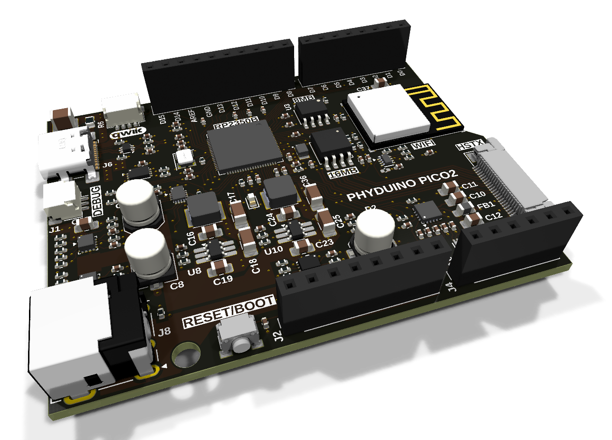
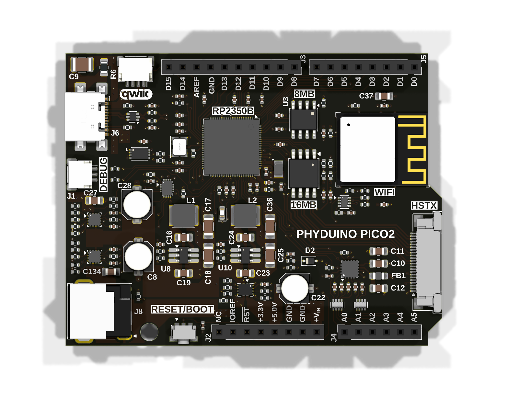

# Phyduino Pico 2

An Arduino Uno-style development board built around the Raspberry Pi **RP2350** microcontroller, designed by the University of Toronto Department of Physics, Electronics Support Services, for the [Introduction to Electronics](https://plrs.physics.utoronto.ca/course-listing/) course. Students assemble part of the board themselves, learning surface-mount soldering, microcontroller programming, analogue-to-digital conversion and digital communication.

**Project site:** <https://perc-sw.github.io/phyduino_pico2> (schematic, interactive BOM, PCB drawings, 3D model and datasheets)

> **Status:** Rev A0 prototype (October 2026).

## Features

### Microcontroller and memory
- **RP2350B** (QFN-80): dual Arm Cortex-M33 or Hazard3 RISC-V cores, 12 MHz crystal
- **16 MB** QSPI NOR flash (AT25QF128A)
- **8 MB** QSPI PSRAM (IS66WVR8M8FBLL)
- **8 KB** I²C EEPROM (24AA64)

### Analogue inputs
- Six analogue inputs (**A0–A5**) measured by an 8-channel, **12-bit SAR ADC** (ADS7038) on SPI
- The ADC runs from a dedicated 5 V analogue supply, with an **AREF** pin on the header
- The board's input voltage is monitored by one of the RP2350's own ADC inputs

### Wireless
- **ESP32-C6-MINI-1** module: 2.4 GHz Wi-Fi 6 and Bluetooth 5 (LE). The pin-compatible ESP32-C61-MINI-1 can be fitted instead.
- Runs [ESP-AT](https://github.com/perc-sw/esp-at) firmware as a network co-processor, connected to the RP2350 over UART with RTS/CTS flow control
- The RP2350 controls the module's enable and boot pins, and a separate UART is provided for loading the module's firmware

### Connectors and I/O
- **Arduino Uno R3 form factor** (68.6 × 53.3 mm) with standard headers: D0–D15, A0–A5, AREF, IOREF, RESET, 3.3 V, 5 V and VIN
- **USB-C:** USB 2.0 and 5 V power, with ESD protection
- **Qwiic / STEMMA QT** connector (I²C on D14/D15, 3.3 V)
- **HSTX connector** (22-pin, 0.5 mm FFC): the RP2350's four high-speed differential HSTX lanes, plus I²C and two GPIO
- **SWD debug connector** (3-pin JST-SH, Raspberry Pi debug probe pinout)
- **I²C GPIO expander** (FXL6408) for power-path status and control

### Power
- Two inputs:
  - **USB-C:** 4.5–5.5 V, up to 3 A
  - **DC barrel jack** (2.1 mm): 4.5–22 V, up to 3 A
- Each input has a **TPS25947 eFuse** with over-voltage, under-voltage and reverse-current protection and current limiting (2.6 A)
- **AP63200** synchronous buck regulators generate the 3.3 V and 5 V rails
- A **TPS2121** power mux supplies the 5 V rail:
  - from the 5 V regulator when the input is above 5.5 V
  - directly from the input otherwise, for example on USB power

### Reset and boot
- One **RESET/BOOT** button, handled by a TPS3424 push-button controller:
  - **Short press:** reset and run the program in flash
  - **Long press (about 2 s):** restart in **UF2 (BOOTSEL) mode**, where the board appears as a USB drive for drag-and-drop programming

## Repository layout

| Path | Contents |
|---|---|
| `phyduino_pico2.kicad_pro` | KiCad project (net classes, design rules, DRC exclusions) |
| `phyduino_pico2.kicad_sch` | Root schematic, with the Microcontroller, Power and Wireless Communication sub-sheets |
| `phyduino_pico2.kicad_pcb` | 4-layer PCB |
| `fabrication/` | Gerber and drill files |

## Opening the design

The design files are in **KiCad 10** format and can't be opened with earlier versions.

Some symbols and footprints come from the maintainer's own libraries, which aren't in this repository. KiCad may report these as missing library links. The board and schematic still open and plot correctly, because every footprint and symbol is stored in the design files.

The board's silkscreen and copper text use Liberation Sans, Tekton, Centaur and Photograph Signature. Install the fonts in [`.github/workflows/fonts/`](.github/workflows/fonts/) so the text renders as it does on the fabricated board.

## Related projects

- 

## Licence

Released under the GNU General Public License v3.0. See [LICENSE](LICENSE).

University of Toronto, Department of Physics: [Electronics Support Services](https://www.physics.utoronto.ca/physics-at-uoft/services/plrs/electronic-support-services/)
